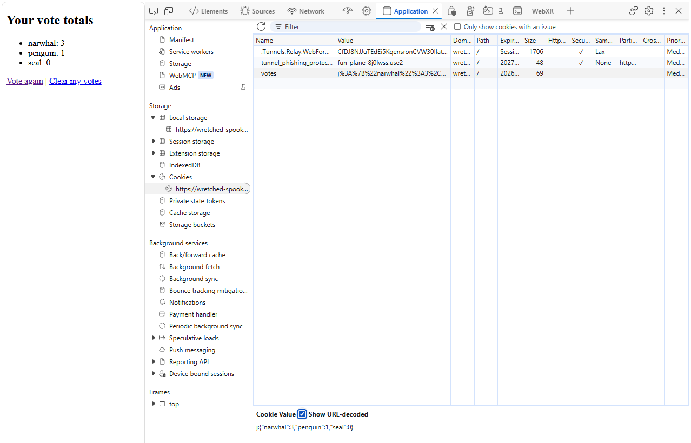

# Node.js + Express + hbs Starter

**CIM 343/643 – Front End Fundamentals**

Build a small web server with **Express** that uses **hbs** (Handlebars) templates to render a page from data. Everything runs in **GitHub Codespaces**, so you don't need to install anything on your computer.

Tested with Node 22, express 5.3, and hbs 4.4.

---

## Final folder structure

```
your-repo/
├── .gitignore
├── app.js
├── package.json
├── package-lock.json
├── README.md
├── assets/            (images for this README)
├── node_modules/      (created by npm, not pushed to GitHub)
├── public/            (optional: CSS, images, browser JS)
└── views/
    ├── layout.hbs
    ├── home.hbs
    ├── animalloop.hbs
    ├── survey.hbs     (Part 2)
    └── response.hbs   (Parts 2 and 3)
```

---

## Step 0 – Open your repo in a Codespace

1. Go to your repository on GitHub.
2. Click the green **Code** button, then the **Codespaces** tab.
3. Click **Create codespace on main**.
4. Wait for VS Code to load in the browser. The terminal is at the bottom. If you don't see it, use **Terminal → New Terminal**.

Node and npm come preinstalled in Codespaces. Check with:

```bash
node -v
npm -v
```

> Make sure the terminal is in the **same folder** as your project. In Codespaces that's usually `/workspaces/<your-repo-name>`. Run `pwd` to check.

---

## Step 1 – Create the project and install packages

```bash
npm init -y
npm install express hbs
```

- `npm init -y` creates `package.json`, which lists your project's packages and scripts.
- `npm install express hbs` downloads both packages into `node_modules/` and adds them to `"dependencies"`.

Check that both installed:

```bash
npm ls
```

You should see `express@5.x` and `hbs@4.x`.

---

## Step 2 – Add `.gitignore` and a start script

Create a file named `.gitignore` with one line:

```
node_modules/
```

This keeps the large `node_modules/` folder off GitHub. Anyone who clones the repo runs `npm install` to get it back.

Next, open `package.json` and add a `start` line inside `"scripts"`. Put a comma after the line before it:

```json
{
  "name": "your-repo",
  "version": "1.0.0",
  "main": "app.js",
  "scripts": {
    "test": "echo \"Error: no test specified\" && exit 1",
    "start": "node app.js"
  },
  "dependencies": {
    "express": "^5.3.0",
    "hbs": "^4.4.0"
  }
}
```

Now `npm start` runs `node app.js` for you.

---

## Step 3 – Write `app.js`

```js
const express = require("express");
const app = express();
const port = 3000;

// Set up hbs: one line, no require needed
app.set("view engine", "hbs");

// Serve files from the "public" folder (HTML, CSS, JS)
app.use(express.static("public"));

// A simple route
app.get("/", (req, res) => {
  res.send("Hello from Express!");
});

// A simple handlebars example
app.get("/home", (req, res) => {
  res.render("home", { title: "My Home Page" });
});

// Loop over an array in a template
app.get("/animalloop", (req, res) => {
  res.render("animalloop", {
    title: "My Animals",
    animals: ["narwhal", "penguin", "seal"]
  });
});

// A route that sends JSON
app.get("/api/animals", (req, res) => {
  res.json(["narwhal", "penguin", "seal"]);
});

app.listen(port, () => {
  console.log(`Server running at http://localhost:${port}`);
});
```

- `res.send(...)` sends plain text or HTML back to the browser.
- `app.set("view engine", "hbs")` tells Express to look in `views/` for `.hbs` files. You don't need `require("hbs")`.
- `res.render("animalloop", {...})` fills in `views/animalloop.hbs` with the data and sends the HTML.
- `res.json(...)` sends data instead of a page. You'll use that with `fetch()` later.

---

## Step 4 – Create the views

Make a folder named `views` with three files in it.

**`views/layout.hbs`** is the page shell every page shares. hbs uses a file with this exact name automatically.

```html
<!DOCTYPE html>
<html>
<head><title>Express + hbs</title></head>
<body>
  {{{body}}}
</body>
</html>
```

**`views/home.hbs`** is the content that goes where `{{{body}}}` is:

```html
<h1>{{title}}</h1>
```

**`views/animalloop.hbs`** loops over the `animals` array:

```html
<h1>{{title}}</h1>
<ul>
  {{#each animals}}
    <li>{{this}}</li>
  {{/each}}
</ul>
```

| Syntax | What it does |
| --- | --- |
| `{{title}}` | Inserts a value, with HTML escaped for safety |
| `{{{body}}}` | Inserts raw HTML (used only for the page content in the layout) |
| `{{#each animals}} ... {{/each}}` | Loops over an array, like a `for` loop |
| `{{this}}` | The current item inside `#each` |

To add CSS, create `public/style.css` and add `<link rel="stylesheet" href="/style.css">` inside `<head>` in the layout.

---

## Step 5 – Run it in Codespaces

```bash
npm start
```

You'll see `Server running at http://localhost:3000`. In a Codespace, don't click that link. Use the forwarded address instead:

1. A pop-up appears in the bottom-right corner: **"Your application running on port 3000 is available."** Click **Open in Browser**.
2. If you missed the pop-up, open the **Ports** tab (next to Terminal), find port **3000**, and click the globe icon.

The page opens at an address like `https://<codespace-name>-3000.app.github.dev` and shows **Hello from Express!** Add these to the end of the address to try the other routes:

| Add to the address | You'll see |
| --- | --- |
| `/home` | The `home.hbs` page |
| `/animalloop` | The list of animals from `animalloop.hbs` |
| `/api/animals` | The raw JSON |

Press **Ctrl+C** in the terminal to stop the server. After you change `app.js`, stop and restart the server to see your changes. Changes to `.hbs` files show up when you refresh the page.

---

## Step 6 – Commit and push

From the terminal:

```bash
git add .
git commit -m "Add Express + hbs app"
git push
```

You can also use the **Source Control** icon in the left sidebar: type a message, click **Commit**, then **Sync Changes**.

Codespaces is already signed in to GitHub, so you won't be asked for a password.

---

## Troubleshooting

| Problem | Cause | Fix |
| --- | --- | --- |
| `Error: Cannot find module 'hbs'` | hbs isn't installed in this folder | Run `npm install hbs` in the folder that has `package.json` and `app.js`, then `npm start` again |
| `npm start` gives a JSON parse error | A missing or extra comma in `package.json` | Every line in `"scripts"` except the last needs a comma |
| `Missing script: "start"` | No start script, or it's in the wrong place | Add `"start": "node app.js"` inside `"scripts"` |
| Home page ignores your template | `public/index.html` exists and is served first | Delete or rename `public/index.html` |
| `Failed to lookup view "home"` | The file is misnamed or in the wrong folder | It must be `views/home.hbs` |
| `EADDRINUSE: port 3000` | The server is already running | Press Ctrl+C in the other terminal, or change `port` |
| No pop-up and nothing in the Ports tab | The server isn't running | Check the terminal for errors and run `npm start` again |
| Fresh Codespace says modules are missing | `node_modules/` isn't in GitHub | Run `npm install` first |

> **GitHub Pages can't run this app.** Pages only hosts static files (HTML, CSS, browser JS). A Node server has to run with `npm start` in a Codespace or on a computer.

---

# Part 2 – Processing a Form

The browser shows a form. When the user clicks **Submit**, the form data goes to the server. The server reads it and renders a response page.

```
GET  /form   →  show the form       (views/survey.hbs)
POST /form   →  read the data, show the response (views/response.hbs)
```

## Step 1 – Let Express read form data

In `app.js`, add this line **above your routes**, next to `express.static`:

```js
app.use(express.urlencoded({ extended: true }));
```

Without it, `req.body` is `undefined`.

## Step 2 – Create the form in `views/survey.hbs`

```html
<h1>Favorite Animal Survey</h1>

<form action="/form" method="POST">
  <label for="name">Your name:</label>
  <input type="text" id="name" name="name" required>

  <label for="animal">Favorite animal:</label>
  <select id="animal" name="animal">
    <option value="narwhal">Narwhal</option>
    <option value="penguin">Penguin</option>
    <option value="seal">Seal</option>
  </select>

  <button type="submit">Submit</button>
</form>
```

- `action="/form"` is the route the data is sent to.
- `method="POST"` sends the data in the request body.
- Each input's **`name`** becomes a key in `req.body`, so `name="name"` becomes `req.body.name`.

## Step 3 – Create the response page in `views/response.hbs`

```html
<h1>Thanks, {{name}}!</h1>
<p>Your favorite animal is the <strong>{{animal}}</strong>.</p>
<a href="/form">Submit another</a>
```

## Step 4 – Add the two routes in `app.js`

```js
// Show the form
app.get("/form", (req, res) => {
  res.render("survey", { title: "Survey" });
});

// Process the form
app.post("/form", (req, res) => {
  const name = req.body.name;
  const animal = req.body.animal;

  console.log("Form received:", req.body);

  res.render("response", {
    title: "Thanks!",
    name: name,
    animal: animal
  });
});
```

The `GET` and `POST` routes can share the same path. Express picks the route by the request's method.

## Step 5 – Test it

1. Stop the server with **Ctrl+C**, then run `npm start` again.
2. Open your Codespace URL and add `/form` to the end.
3. Fill in the form and click **Submit**.
4. You should see the response page. The terminal also shows `Form received: { name: '...', animal: '...' }`.

## Form troubleshooting

| Problem | Fix |
| --- | --- |
| `Cannot read properties of undefined (reading 'name')` | Add `app.use(express.urlencoded({ extended: true }))` above the routes |
| `Cannot POST /form` | Add the `app.post("/form", ...)` route, then restart the server |
| A value shows up blank | The input's `name` attribute must match what you read from `req.body` |
| Your changes don't appear | Restart the server after you edit `app.js` |

> **Safe by default:** `{{name}}` escapes HTML. If someone types `<b>hi</b>`, it shows as text instead of bold.

## Bonus – Sending data in the URL (route parameters)

A form isn't the only way to send data to the server. You can also put it **right in the URL**. A route parameter is a part of the path that starts with a colon (`:`). Express saves whatever is typed there in `req.params`.

```js
app.get("/:name", (req, res) => {
  res.send("My name is: " + req.params.name);
});
```

| You visit | `req.params.name` | Page shows |
| --- | --- | --- |
| `/Zeven` | `"Zeven"` | My name is: Zeven |
| `/penguin` | `"penguin"` | My name is: penguin |

The word after the colon becomes the key. `/:name` gives you `req.params.name`, and `/:animal` would give you `req.params.animal`.

### Order matters

`/:name` matches **any** single word after `/`, including `/form` and `/clear`. Express uses the first route that matches, so put this route **last**, below all your other routes:

```js
app.get("/form", ...);     // checked first
app.post("/form", ...);
app.get("/clear", ...);

app.get("/:name", ...);    // checked last, catches everything else
```

If `/:name` is at the top, visiting `/form` shows "My name is: form" instead of your form.

> You may see `My name is: favicon.ico` in the terminal or browser. That's the browser asking for the tab icon, and `/:name` caught that request too.

### More than one parameter

```js
app.get("/vote/:animal/:count", (req, res) => {
  res.send(req.params.animal + " got " + req.params.count + " votes");
});
```

Visiting `/vote/seal/5` shows **seal got 5 votes**. Starting the path with a fixed word like `/vote/` also keeps this route from catching `/form`.

### Use it with hbs

```js
app.get("/hello/:name", (req, res) => {
  res.render("hello", { name: req.params.name });
});
```

`views/hello.hbs`:

```html
<h1>Hello, {{name}}!</h1>
```

`res.render` with `{{name}}` escapes HTML, so it's safer than building HTML with `res.send` when the text comes from the URL.

### Form data vs. URL data

| | Form (`POST`) | Route parameter |
| --- | --- | --- |
| Where the data is | In the request body | In the URL path |
| How you read it | `req.body.name` | `req.params.name` |
| Needs `express.urlencoded`? | Yes | No |
| Can be bookmarked or shared? | No | Yes |

---

# Part 3 – Counting Votes with a Cookie

A **cookie** is a small piece of data the server asks the browser to save. The browser sends it back with every request, so the server can remember things between form submissions.

In this part, the cookie keeps a **count for each animal**. Every time you vote, that animal's count goes up by 1, and the response page shows the totals.

```
1. Browser POSTs the form, sending along its "votes" cookie (if it has one)
2. Server reads the cookie   → { narwhal: 0, penguin: 1, seal: 2 }
3. Server adds 1 to the vote → { narwhal: 0, penguin: 1, seal: 3 }
4. Server sends the updated cookie back with the response page
```

## Step 1 – Install cookie-parser

```bash
npm install cookie-parser
```

## Step 2 – Turn it on in `app.js`

At the top, next to the other `require` lines:

```js
const cookieParser = require("cookie-parser");
```

Below `express.urlencoded(...)`, above the routes:

```js
app.use(cookieParser());
```

Now `req.cookies` holds every cookie the browser sent.

## Step 3 – Update the POST route

Replace your `app.post("/form", ...)` route with:

```js
app.post("/form", (req, res) => {
  const animal = req.body.animal;

  // 1. Start every animal at 0 votes
  let votes = {
    narwhal: 0,
    penguin: 0,
    seal: 0
  };

  // 2. If the browser already has a votes cookie, use those counts instead
  if (req.cookies.votes !== undefined) {
    votes = req.cookies.votes;
  }

  // 3. If this animal isn't in the list yet, start it at 0
  if (votes[animal] === undefined) {
    votes[animal] = 0;
  }

  // 4. Add 1 vote to the animal they picked
  votes[animal] = votes[animal] + 1;

  // 5. Save the updated counts back to the cookie
  res.cookie("votes", votes, { maxAge: 7 * 24 * 60 * 60 * 1000 });

  res.render("response", {
      votes: votes
  });
});
```

- `votes` is an **object**: each animal is a key, and its value is that animal's count.
- `votes[animal]` uses the variable as the key. If `animal` is `"seal"`, it's the same as `votes.seal`.
- Step 3 matters if you add a new `<option>` to the form later. Without it, the new animal would start as `undefined + 1`, which is `NaN`.
- `res.render("response", { votes: votes })` passes only `votes` to the page, so `response.hbs` can use `{{votes}}` but not `{{name}}` or `{{animal}}`. That's why the route no longer reads `req.body.name`.
- `res.cookie("votes", votes)` can save an object. Express turns it into text, and cookie-parser turns it back into an object on the next request.

### Why `maxAge`?

`maxAge` sets how long the browser keeps the cookie. Without it, the votes disappear when the student closes the browser.

- **Without `maxAge`:** it's a session cookie, deleted when the browser closes, so the counts start over at 0 next time.
- **With `maxAge`:** the browser keeps it for that amount of time, even after it's closed and reopened.

`maxAge` is in **milliseconds**, so the math works out to 7 days:

```
7 days × 24 hours × 60 minutes × 60 seconds × 1000 milliseconds
= 604,800,000 milliseconds
= 1 week
```

It's optional. If you don't need the votes to last, the simplest version is:

```js
res.cookie("votes", votes);
```

Or you can make the time easier to read and change:

```js
const oneWeek = 7 * 24 * 60 * 60 * 1000;
res.cookie("votes", votes, { maxAge: oneWeek });
```

> **Try it:** set `maxAge: 60000` (one minute). Vote, wait a minute, refresh, and watch the counts reset.

## Step 4 – Add a route to clear the counts

```js
app.get("/clear", (req, res) => {
  res.clearCookie("votes");
  res.redirect("/form");
});
```

## Step 5 – Show the totals in `views/response.hbs`

```html
<h2>Your vote totals</h2>
<ul>
  {{#each votes}}
    <li>{{@key}}: {{this}}</li>
  {{/each}}
</ul>

<a href="/form">Vote again</a> |
<a href="/clear">Clear my votes</a>
```

When `#each` loops over an object, `{{@key}}` is the key (the animal) and `{{this}}` is the value (the count).

## Step 6 – Test it

1. Restart the server: **Ctrl+C**, then `npm start`.
2. Go to `/form` and vote several times for different animals. Each count goes up by 1 when you vote for it.
3. Look at the `votes` cookie in DevTools (see the next section).
4. Click **Clear my votes** and the counts start over at 0.

## Viewing the cookie in your browser



**Chrome or Edge**

1. Open your app and vote at least once.
2. Open DevTools: **F12**, **Ctrl+Shift+I** (Windows), or **Cmd+Option+I** (Mac).
3. Click the **Application** tab at the top. In Edge, if you don't see it, click **+** (More tools) and choose **Application**.
4. In the left sidebar, open **Storage → Cookies**, then click your Codespace address (`https://<codespace-name>-3000.app.github.dev`).
5. Click the **votes** row. Check **Show URL-decoded** at the bottom to see the readable value.

**Firefox:** the steps are the same, except the tab is called **Storage**.

**Safari:** first turn on **Settings → Advanced → Show features for web developers**, then press **Cmd+Option+I** and go to **Storage → Cookies**.

**Reading the screenshot**

- The page on the left shows `narwhal: 3, penguin: 1, seal: 0`, and the cookie value at the bottom shows the same counts: `j:{"narwhal":3,"penguin":1,"seal":0}`. The `j:` means it's saved as JSON.
- Without **Show URL-decoded**, the value looks scrambled (`j%3A%7B%22narwhal%22...`). That's the same data, URL-encoded.
- The **Expires** column shows a date one week out, set by `maxAge`.
- The other two cookies (`.Tunnels.Relay...` and `tunnel_phishing_protection`) belong to Codespaces, not your app. You can ignore them.

**Try this:** double-click the value, change a number, and vote again. The server trusts whatever the cookie says, which is why cookies shouldn't hold anything important. Select the cookie and press **Delete** to reset the votes without using `/clear`.

## Bonus – Clearing votes with a DELETE route

Right now `/clear` is a `GET` route. It works, but **GET requests should only read data, never change it**. A GET that changes data can be triggered by accident, for example when a browser preloads a link. Deleting the votes is a change, so a `DELETE` route is a better fit.

The catch: **HTML links and forms can only send `GET` and `POST`.** To send a DELETE, the browser needs JavaScript and `fetch()`.

### Step 1 – Change the route in `app.js`

Replace `app.get("/clear", ...)` with:

```js
app.delete("/clear", (req, res) => {
  res.clearCookie("votes");
  res.send("Votes cleared");
});
```

This route sends a message instead of redirecting, because `fetch()` doesn't move the browser to a new page.

### Step 2 – Swap the link for a button in `views/response.hbs`

Replace the **Clear my votes** link with:

```html
<button id="clearBtn">Clear my votes</button>

<script>
  let clearBtn = document.getElementById("clearBtn");

  clearBtn.addEventListener("click", function () {
    fetch("/clear", { method: "DELETE" })
      .then(function () {
        window.location.href = "/form";
      });
  });
</script>
```

1. When the button is clicked, `fetch()` sends a **DELETE** request to `/clear`.
2. The server's response deletes the `votes` cookie.
3. `.then(...)` runs after the server answers and sends the browser back to `/form`.

### Where does `res.send("Votes cleared")` go?

With a link or a form, the browser shows the server's response automatically. With `fetch()`, **the response comes back to your JavaScript, not to the page**. The browser only shows it if your code puts it there.

In the version above, the response arrives but is never read. `.then(function () { ... })` has no parameter, and `window.location.href` loads a new page right away. That's why you never see "Votes cleared."

To show the response instead, read it and put it on the page:

```js
// Old: ignore the response, go somewhere else
fetch("/clear", { method: "DELETE" })
  .then(function () {
    window.location.href = "/form";
  });

// New: read the response and show it on this page
fetch("/clear", { method: "DELETE" })
  .then(function (response) {
    return response.text();
  })
  .then(function (text) {
    message.innerHTML = text;
  });
```

- The first `.then` gets the `response` object. `response.text()` reads what the server sent, but the text isn't ready right away, so it returns a promise.
- The second `.then` waits for that text and puts it inside `<div id="message"></div>`.
- Writing `message.innerHTML = response` directly shows `[object Response]`, because `response` is an object, not the text.

To try the new version, replace the button and script in `views/response.hbs` with:

```html
<button id="clearBtn">Clear my votes</button>
<div id="message"></div>

<script>
  let clearBtn = document.getElementById("clearBtn");
  let message = document.getElementById("message");

  clearBtn.addEventListener("click", function () {
    fetch("/clear", { method: "DELETE" })
      .then(function (response) {
        return response.text();
      })
      .then(function (text) {
        message.innerHTML = text;
      });
  });
</script>
```

Then change the route so its response includes a link back:

```js
app.delete("/clear", (req, res) => {
  res.clearCookie("votes");
  res.send("Votes cleared. <a href='/form'>Back to form</a>");
});
```

Click **Clear my votes** and the message appears under the button. The vote totals stay on screen until you reload the page, even though the cookie is already gone.

### Step 3 – Test it

1. Restart the server, vote a few times, then click **Clear my votes**.
2. In DevTools, open the **Network** tab and click the `clear` request. It shows **Request Method: DELETE**.
3. Check **Application → Cookies**. The `votes` cookie is gone.
4. Type `/clear` in the address bar and you'll get `Cannot GET /clear`. That's expected, because typing a URL always sends a GET, and there's no GET route for `/clear` anymore.

### HTTP methods so far

| Method | Purpose | In this app |
| --- | --- | --- |
| `GET` | Read or show something | `app.get("/form")` shows the form |
| `POST` | Send new data | `app.post("/form")` adds a vote |
| `DELETE` | Remove something | `app.delete("/clear")` deletes the cookie |

## Cookie troubleshooting

| Problem | Fix |
| --- | --- |
| `req.cookies` is `undefined` | Add `app.use(cookieParser())` above the routes |
| `Cannot find module 'cookie-parser'` | Run `npm install cookie-parser` in the project folder |
| A count shows `NaN` | The animal wasn't in `votes` yet. Make sure step 3 of the route is there, then click **Clear my votes**. |
| Counts never go past 1 | Make sure you call `res.cookie(...)` **before** `res.render(...)` |
| Votes from another browser don't show | That's expected. Each browser keeps its own cookies. |

> **Cookies live in the browser, not on the server.** Each student sees only their own vote counts, and users can see and edit cookies. Don't store passwords or anything private in one.